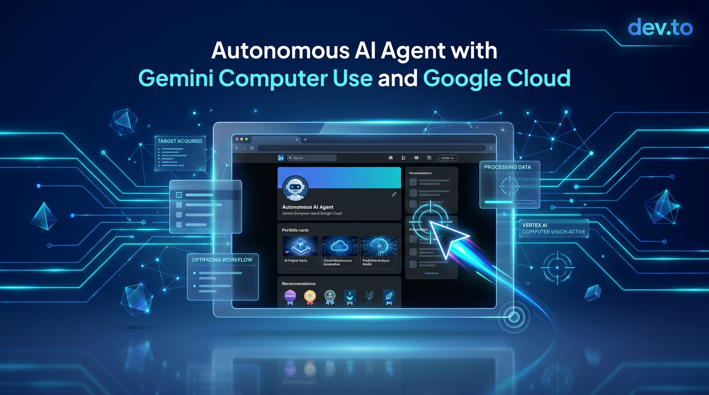
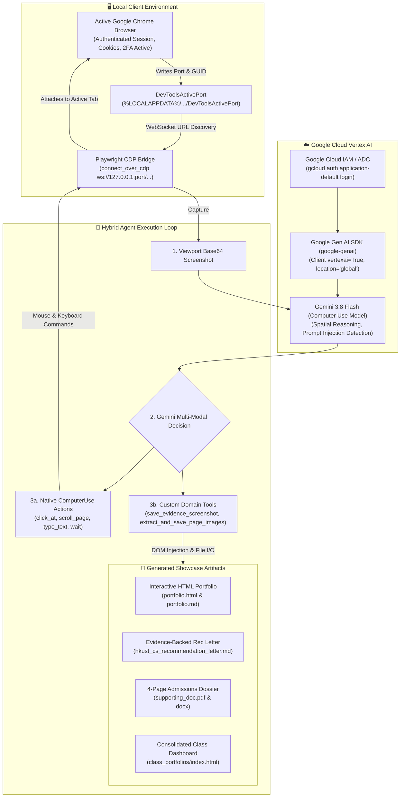
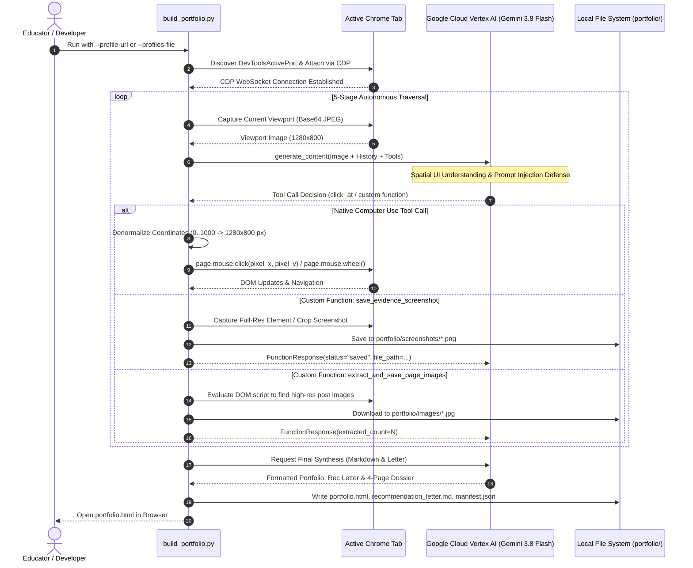
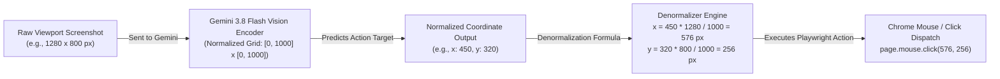
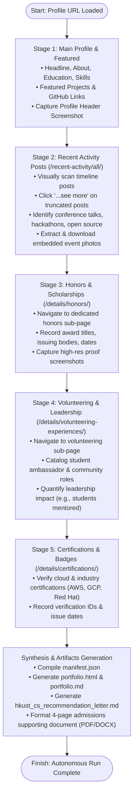
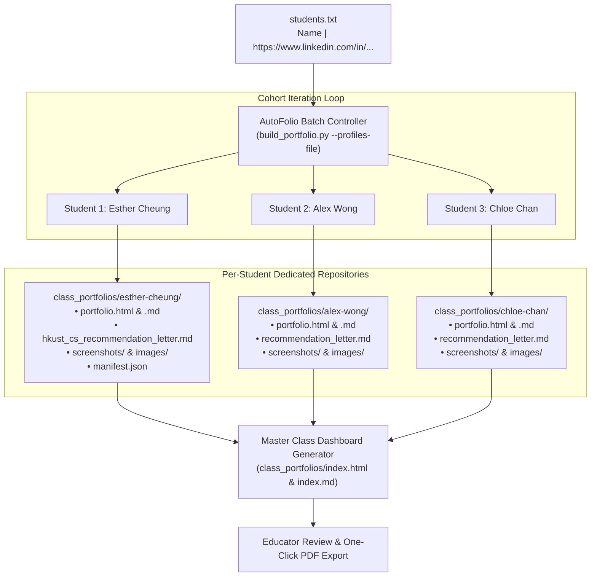

*Author: **Cyrus Wong** — AWS Hero / Educator / Tech Innovator. Published under the **Google Developer Expert (GDE) / Google Cloud** community blog series.*

---



## The Promise and the Pitfall of "Computer Use"

When Google announced **Gemini Computer Use** capabilities on Vertex AI, the developer community immediately saw the potential: AI agents that don't just read JSON APIs or parse headless HTML, but actually **see** the screen, understand spatial UI layouts, click buttons, scroll feeds, and interact with complex web applications just like a human engineer.

However, if you've tried deploying automated browser agents into production, you've probably run into the **"Cold-Start Authentication Wall"**:

1. **2FA & Captchas**: Modern enterprise portals (LinkedIn, Google Cloud Console, Jira, Salesforce) vigorously block automated login attempts from blank headless browser instances.
2. **Credential Leaks**: Hardcoding your enterprise passwords or session cookies into scripts or environment variables is a major security risk.
3. **Session Loss**: Even with storage state dumps, token rotation breaks automated runs mid-flight.

To solve this, I built **[Gemini Computer Use LinkedIn AutoFolio](https://github.com/wongcyrus/gemini-computer-use-linkedin-autofolio)** — an open-source autonomous agent powered by **Google Cloud Vertex AI** (`gemini-3.8-flash`), the **Google Gen AI SDK (`google-genai`)**, and **Playwright CDP Attach**.

Instead of trying to bypass login forms or scraping messy HTML, AutoFolio attaches directly to your **already logged-in Google Chrome browser** via the Chrome DevTools Protocol (`DevToolsActivePort`). It then visually traverses LinkedIn profiles, navigates deep sub-pages (Honors, Volunteering, Certifications, Activity Posts), clicks *"…more"*, captures high-resolution visual evidence, and generates:

- **An Interactive Visual Web Portfolio (`portfolio.html` & `portfolio.md`)** with embedded event photos and verified screenshot proof.
- **An Evidence-Backed University / Job Recommendation Letter (`hkust_cs_recommendation_letter.md`)** grounded in concrete architectural contributions and verified awards.
- **A 4-Page Executive Supporting Document (PDF / DOCX / HTML)** formatted with high-density visual proof for competitive admissions or job applications.
- **Batch Class Processing (`students.txt`)** with an automated central class dashboard for educators and team leads.

In this deep dive, I'll walk through the architecture, Google Cloud configuration, CDP attach technique, and **Hybrid Tool Calling** that make this possible.

---

## High-Level Solution Architecture

Here is the end-to-end architecture of AutoFolio, showing how Vertex AI, Chrome DevTools Protocol, and Playwright work in concert:




---

## Agent Execution Loop: Step-by-Step Sequence

To understand how Gemini Computer Use iteratively interacts with the browser, here is the full execution loop sequence diagram:



---

## 1. Setting Up Google Cloud Vertex AI & Gemini Computer Use

Google Cloud provides enterprise-grade access to Gemini through the unified **Google Gen AI SDK (`google-genai`)**.

### Authentication via Google Cloud Application Default Credentials (ADC)

Rather than juggling API keys, we leverage standard Google Cloud IAM via ADC:

```powershell
# Authenticate your local development environment
gcloud auth application-default login

# Configure Google Cloud environment variables
$env:GOOGLE_CLOUD_PROJECT = "your-gcp-project-id"
$env:GOOGLE_CLOUD_LOCATION = "global"
$env:GOOGLE_GENAI_USE_ENTERPRISE = "True"
```

### Initializing the Vertex AI Client in Python

With the new `google-genai` SDK, initializing Vertex AI with Computer Use is clean and concise:

```python
import os
from google import genai
from google.genai import types

project_id = os.environ.get("GOOGLE_CLOUD_PROJECT", "your-gcp-project-id")
location = os.environ.get("GOOGLE_CLOUD_LOCATION", "global")

client = genai.Client(
    vertexai=True,
    project=project_id,
    location=location,
)
```

### Defining the Computer Use Tool with Enterprise Security

Gemini's Computer Use tool comes with built-in prompt injection defense:

```python
computer_use_tool = types.Tool(
    computer_use=types.ComputerUse(
        environment=types.Environment.ENVIRONMENT_BROWSER,
        enable_prompt_injection_detection=True
    )
)
```

> **Security Tip**: Setting `enable_prompt_injection_detection=True` is critical when your agent navigates public user-generated content on platforms like LinkedIn, protecting your agent from adversarial prompts hidden in profile bios or posts.

---

## 2. The Secret Sauce: Connecting to Active Chrome via `DevToolsActivePort`

If you try to launch a fresh Chromium browser, LinkedIn will hit you with auth walls and CAPTCHAs. 

Instead, we tell Chrome to expose its DevTools port, and our Python agent attaches directly to the **user's active, authenticated browser tab**.

### How `DevToolsActivePort` Auto-Discovery Works

On Windows, macOS, and Linux, whenever Chrome is running with remote debugging enabled, it writes its active port and browser GUID to a file named `DevToolsActivePort` inside the user data directory:

```python
from pathlib import Path
import os

def discover_active_chrome_ws_url() -> str:
    """Auto-detect active Chrome debugger WebSocket URL from DevToolsActivePort."""
    candidate_paths = [
        Path(os.environ.get("LOCALAPPDATA", "")) / "Google" / "Chrome" / "User Data" / "DevToolsActivePort",
        Path.home() / ".config" / "google-chrome" / "DevToolsActivePort",
        Path.home() / "Library" / "Application Support" / "Google" / "Chrome" / "DevToolsActivePort",
    ]
    
    for path in candidate_paths:
        if path.is_file():
            lines = path.read_text(encoding="utf-8").splitlines()
            if len(lines) >= 2:
                port = lines[0].strip()
                guid = lines[1].strip()
                ws_url = f"ws://127.0.0.1:{port}/devtools/browser/{guid}"
                return ws_url
                
    return "http://localhost:9222"
```

### Attaching with Playwright

Connecting Playwright to the active browser takes just a few lines:

```python
from playwright.sync_api import sync_playwright

playwright = sync_playwright().start()
ws_url = discover_active_chrome_ws_url()

# Connect over CDP
browser = playwright.chromium.connect_over_cdp(ws_url)
context = browser.contexts[0]

# Pick up the active LinkedIn tab without opening a blank one
page = context.pages[0] if context.pages else context.new_page()
```

Zero re-login, zero 2FA prompts, zero cookies written to disk. The agent inherits your live session instantly.

---

## 3. Coordinate Normalization & Denormalization Pipeline

One of the most elegant architectural choices in Gemini Computer Use is its resolution-independent coordinate system. Gemini's visual perception engine processes all screenshots on a normalized `[0, 1000]` grid:



The mathematical transformation is clean and reliable:

$$\text{pixel\_x} = \frac{\text{normalized\_x} \times \text{viewport\_width}}{1000}$$

$$\text{pixel\_y} = \frac{\text{normalized\_y} \times \text{viewport\_height}}{1000}$$

This ensures that whether you run on a 1080p desktop, a 4K monitor, or a scaled cloud container, Gemini's visual actions hit the exact target buttons without resolution calibration drift.

---

## 4. Hybrid Tool Calling Architecture: Dual-Dispatch Engine

One of the most powerful features of Gemini on Google Cloud is **Hybrid Tool Calling**: you don't have to choose between visual Computer Use or function calling. You can give the model **both** in the exact same prompt configuration!

```mermaid
flowchart TD
    MODEL["Gemini 3.8 Flash on Vertex AI"] -->|Generates Model Turn| CANDIDATE{"Inspect Candidate FunctionCall"}
    
    subgraph NativeComputerUse["🌐 Native ComputerUse Tool (types.ComputerUse)"]
        CANDIDATE -->|click_at(x, y)| CU_CLICK["Translate (x,y) & page.mouse.click()"]
        CANDIDATE -->|scroll_page(direction)| CU_SCROLL["page.mouse.wheel(0, dy)"]
        CANDIDATE -->|type_text_at(text, x, y)| CU_TYPE["page.mouse.click() & page.keyboard.type()"]
        CANDIDATE -->|navigate(url)| CU_NAV["page.goto(url, wait_until='domcontentloaded')"]
        CANDIDATE -->|wait_5_seconds()| CU_WAIT["page.wait_for_timeout(5000)"]
    end

    subgraph CustomDomainTools["🛠️ Custom AutoFolio Tools (FunctionDeclaration)"]
        CANDIDATE -->|save_evidence_screenshot(label, category)| CT_SHOT["Capture high-res proof, watermark, & catalog"]
        CANDIDATE -->|extract_and_save_page_images(category)| CT_IMG["DOM evaluate  tags, download media files"]
        CANDIDATE -->|record_portfolio_item(item_data)| CT_ITEM["Append structured JSON record to manifest.json"]
        CANDIDATE -->|yield_to_user(message)| CT_HITL["Pause for Human-in-the-Loop review"]
    end

    CU_CLICK --> SYNC["Synchronize Browser State & Next Viewport"]
    CU_SCROLL --> SYNC
    CU_TYPE --> SYNC
    CU_NAV --> SYNC
    CU_WAIT --> SYNC
    CT_SHOT --> SYNC
    CT_IMG --> SYNC
    CT_ITEM --> SYNC
    CT_HITL --> SYNC
    
    SYNC -->|Send FunctionResponse + New Screenshot| MODEL
```

### Passing Both Tools to `generate_content`

```python
# Pass both Computer Use and your custom tool definitions
response = client.models.generate_content(
    model="gemini-3.8-flash",
    contents=conversation_history,
    config=types.GenerateContentConfig(
        tools=[computer_use_tool, custom_folio_tools],
        temperature=0.2,
    ),
)
```

When Gemini responds, our loop inspects the candidate calls:

```python
for candidate in response.candidates:
    for part in candidate.content.parts:
        if part.function_call:
            fn_name = part.function_call.name
            fn_args = part.function_call.args
            
            if fn_name == "click_at":
                # Convert normalized (0-1000) coordinates to browser viewport pixels
                x = int(fn_args["x"] * viewport_width / 1000)
                y = int(fn_args["y"] * viewport_height / 1000)
                page.mouse.click(x, y)
                
            elif fn_name == "save_evidence_screenshot":
                # Execute our custom domain tool
                result = save_evidence_screenshot(page, fn_args["label"], fn_args["category"])
                
            elif fn_name == "extract_and_save_page_images":
                result = extract_page_images(page, fn_args["category"])
```

---

## 5. Multi-Stage Autonomous Workflow: Turning Activity into Grounded Evidence

Rather than letting an agent roam aimlessly, AutoFolio runs a disciplined **5-stage exploration pipeline**:



1. **Stage 1 (Main Profile & Featured)**: Scans profile headline, About section, featured projects, and top skills.
2. **Stage 2 (Recent Activity & Posts)**: Visits `/recent-activity/all/`, scrolls down, expands *"…see more"*, captures conference speaking announcements, hackathon podium finishes, and extracts embedded event photos.
3. **Stage 3 (Honors & Scholarships)**: Visits `/details/honors/` to catalog official government and university scholarship awards with exact issuing bodies and dates.
4. **Stage 4 (Volunteering & Community Leadership)**: Visits `/details/volunteering-experiences/` to record tech community leadership (e.g. Red Hat Student Ambassador, AWS Cloud Leader, Google Developer Group).
5. **Stage 5 (Certifications & Badges)**: Visits `/details/certifications/` to validate industry credentials.

---

## 6. Batch Class Processing Architecture

For educators, admissions officers, and engineering team leads, AutoFolio provides an automated batch runner that reads student links from a text file (`students.txt`) and synthesizes an entire cohort in one command:



---

## 7. Real-World Case Study: AutoFolio in Action

As an educator (Senior Lecturer at HKIIT / IVE Lee Wai Lee, Hong Kong), I write dozens of university recommendation letters every year for students transferring into elite Bachelor of Engineering programs (like **HKUST Computer Science**).

Traditional recommendation letters suffer from a common flaw: they rely on vague adjectives (*"hardworking"*, *"passionate"*) because teachers don't have time to dig through 3 years of extracurricular activities.

We ran AutoFolio on the profile of **Hiu Tung Cheung (Esther)**, an outstanding Cloud & Data Centre Administration student with a 3.91 CGPA applying for HKUST CS.

### What Gemini Discovered Autonomously:
- **Conference Speaker**: Traced her verified announcement as a speaker at **PyCon Hong Kong 2026** presenting *"Kubernetes Game Server Orchestration with Agones on Google Cloud"*.
- **Tech Community Leadership**: Identified her role organizing workshops across Red Hat, AWS, and Google Developer Groups (GDG), mentoring over 300 junior students.
- **Top Scholarships**: Documented her HKSAR Government Talent Development Scholarship and Vocational Training Council Excellence Awards.
- **Hands-On Architecture**: Cataloged her open-source full-stack projects combining generative AI, Cloudflare Workers, and multi-cloud infrastructure.

### The Generated Deliverables:
1. **Interactive Visual Portfolio (`portfolio.html`)**: Complete with hero badges, category filters, high-resolution event photos, and clickable verified screenshot modals.
2. **HKUST CS Recommendation Letter (`hkust_cs_recommendation_letter.md`)**: A rigorous 1,200-word recommendation structured across Academic Aptitude, Cloud Systems Architecture, Community Leadership, and Personal Motivation.
3. **4-Page Supporting Document (PDF / DOCX)**: Formatted in an executive 2-column layout (visual evidence on the left, architectural verification on the right) ready for university admissions portals.
4. **Class Dashboard**: When run with `--profiles-file students.txt`, AutoFolio loops through the entire class and produces a unified dashboard with quick links to every student's portfolio and recommendation.

---

## 8. How to Run It in Your Own Environment

You can try this today on your machine with Google Cloud Vertex AI:

### Clone & Install

```powershell
git clone https://github.com/wongcyrus/gemini-computer-use-linkedin-autofolio.git
cd gemini-computer-use-linkedin-autofolio

python -m venv .venv
.\.venv\Scripts\Activate.ps1
pip install -r requirements.txt
playwright install chromium
```

### Authenticate with Google Cloud

```powershell
gcloud auth application-default login
$env:GOOGLE_CLOUD_PROJECT = "your-gcp-project-id"
$env:GOOGLE_CLOUD_LOCATION = "global"
$env:GOOGLE_GENAI_USE_ENTERPRISE = "True"
```

### Start Chrome with Remote Debugging

Either visit `chrome://inspect/#remote-debugging` in Chrome or launch:

```powershell
chrome.exe --remote-debugging-port=9222
```

Navigate to LinkedIn in any tab.

### Run AutoFolio for a Candidate

```powershell
.\.venv\Scripts\python.exe build_portfolio.py `
  --profile-url "https://www.linkedin.com/in/target-profile-handle/" `
  --portfolio-dir portfolio `
  --target-program "Bachelor of Engineering in Computer Science, HKUST" `
  --recommender "Cyrus Wong, Senior Lecturer, HKIIT"
```

Or run for your whole class:

```powershell
.\.venv\Scripts\python.exe build_portfolio.py `
  --profiles-file students.txt `
  --portfolio-dir class_portfolios
```

Once complete, open the visual portfolio:

```powershell
Start-Process .\portfolio\portfolio.html
```

---

## Key Takeaways for Google Cloud Developers

1. **Computer Use is Ready for Production Enterprise Apps**: You don't need dedicated API endpoints for internal dashboards or authenticated sites. Combining Vertex AI's `gemini-3.8-flash` with CDP attach lets agents operate within legitimate, authenticated human sessions.
2. **Hybrid Tooling is the Winning Pattern**: Native GUI actions provide universal web navigation, while custom functions allow your Python code to inject precise DOM scripts, extract media, and persist structured state.
3. **Security First**: Always enable `enable_prompt_injection_detection=True` when dealing with user-generated content from the web to safeguard your agent workflows.
4. **Social Good & Education**: Autonomous agents can remove administrative friction from education and hiring, ensuring that students and candidates are judged on their verified, concrete achievements.

---

## Resources & Open Source Code

- **GitHub Repository**: [wongcyrus/gemini-computer-use-linkedin-autofolio](https://github.com/wongcyrus/gemini-computer-use-linkedin-autofolio)
- **Google Cloud Gemini Computer Use Documentation**: [Cloud Enterprise Agent Platform Docs](https://docs.cloud.google.com/gemini-enterprise-agent-platform/models/computer-use)
- **Google Gen AI Python SDK**: [google-genai on PyPI](https://pypi.org/project/google-genai/)

*Have questions or ideas about building browser agents on Google Cloud? Drop a comment below or open an issue on GitHub!*
