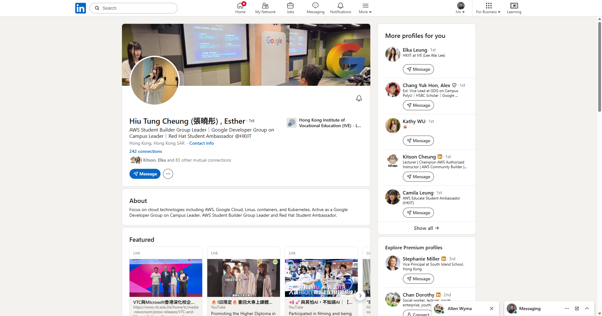
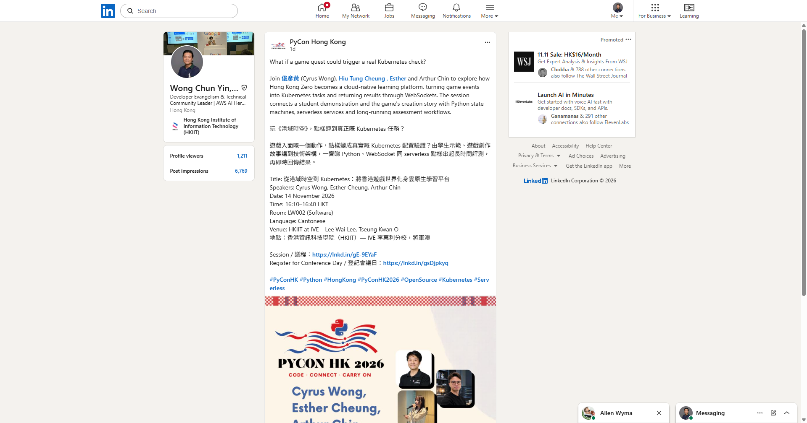
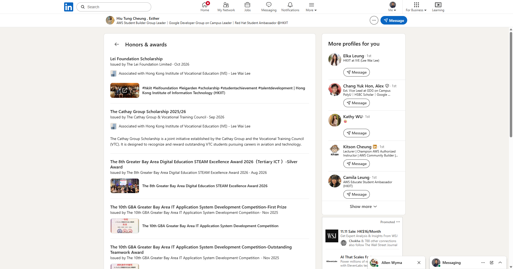
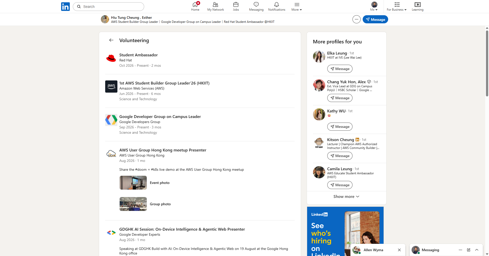
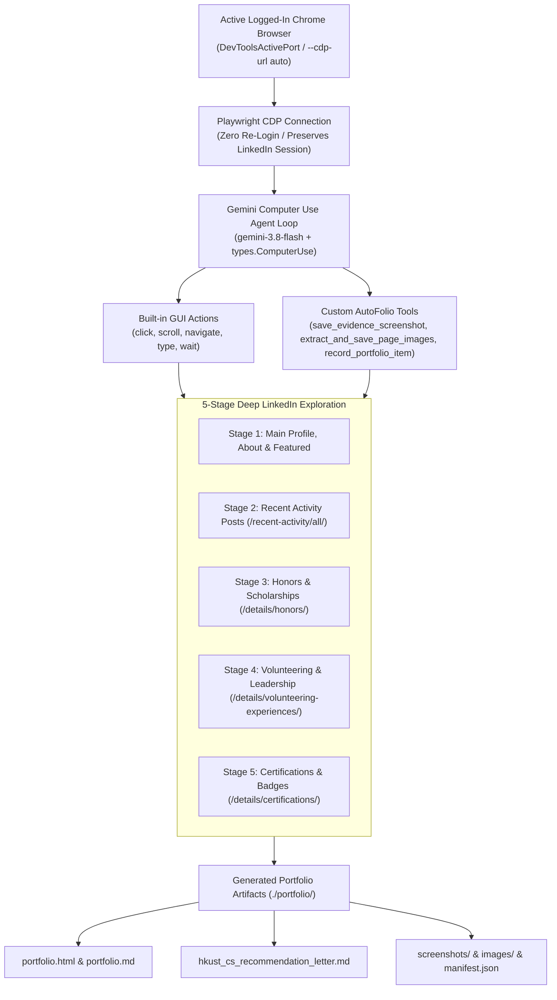

# Gemini Computer Use LinkedIn AutoFolio

[](https://docs.cloud.google.com/gemini-enterprise-agent-platform/models/computer-use)
[](https://www.python.org/)
[](https://playwright.dev/)

**Gemini Computer Use LinkedIn AutoFolio** is an autonomous browser agent powered by the [Google Gen AI SDK (`google-genai`) Computer Use tool](https://docs.cloud.google.com/gemini-enterprise-agent-platform/models/computer-use) and **Playwright CDP Attach**.

Instead of relying on static PDF resumes or shallow profile scrapes, **AutoFolio** attaches directly to your **already logged-in Chrome browser** (`DevToolsActivePort`), visually navigates a candidate or student's **LinkedIn profile and sub-pages** (Activity posts, Honors & Scholarships, Publications, Volunteering, Certifications), clicks *"…more"*, captures verified screenshot proof, downloads event/project photos, and synthesizes:

1. **Interactive Visual Portfolio (`portfolio/portfolio.html` & `portfolio/portfolio.md`)** with embedded event photos and verified LinkedIn screenshots.
2. **Evidence-Backed Academic / Job Recommendation Letter (`portfolio/hkust_cs_recommendation_letter.md`)** grounded in specific project architectures, conference talks, awards, and certifications traced from their real LinkedIn activity.
3. **Structured JSON Manifest (`portfolio/manifest.json`)** cataloging every traced achievement, image, and screenshot.

---

## Live Showcase Example Included in This Repo

This repository includes a complete, real-world run generated by `build_portfolio.py` for **Hiu Tung Cheung (Esther / 張曉彤)** (Higher Diploma in Cloud and Data Centre Administration @ HKIIT / IVE Lee Wai Lee, CGPA 3.91/4.0, applying to **HKUST BEng in Computer Science**):

- **[View Evidence-Backed HKUST CS Recommendation Letter](portfolio/hkust_cs_recommendation_letter.md)**
- **[View Generated Markdown Portfolio](portfolio/portfolio.md)**
- **[View Visual HTML Portfolio](portfolio/portfolio.html)**
- **[View Structured Manifest (`manifest.json`)](portfolio/manifest.json)**

### Sample Verified Evidence Captured Autonomously by Gemini Computer Use

| Profile & Featured Header | PyCon HK 2026 Speaker Announcement |
| :---: | :---: |
|  |  |

| Honors & Scholarships (`details/honors/`) | Volunteering & Leadership (`details/volunteering-experiences/`) |
| :---: | :---: |
|  |  |

---

## Architecture: How It Works



### Key Technical Highlights
- **Zero-Friction Logged-In Chrome Attach (`--cdp-url auto`)**: Reads `%LOCALAPPDATA%\Google\Chrome\User Data\DevToolsActivePort` to attach directly to your active Chrome session over WebSockets (`ws://127.0.0.1:<port>/devtools/browser/<id>`), avoiding login walls, CAPTCHAs, and 2FA prompts.
- **Hybrid Tool Calling (`ComputerUse` + Custom Function Declarations)**: Combines `types.Tool(computer_use=types.ComputerUse(environment=types.Environment.ENVIRONMENT_BROWSER, enable_prompt_injection_detection=True))` with custom Python tools (`save_evidence_screenshot`, `extract_and_save_page_images`, `record_portfolio_item`, `yield_to_user`) in a single agent loop.
- **Built-In Safety & HITL Confirmation**: Respects Gemini Computer Use `safety_decision` (`require_confirmation`) and `enable_prompt_injection_detection=True`.

---

## Getting Started

### 1. Create Virtual Environment & Install Dependencies

```powershell
python -m venv .venv
.\.venv\Scripts\Activate.ps1
pip install -r requirements.txt
playwright install chromium
```

### 2. Configure Google Cloud / Vertex AI Authentication

```powershell
gcloud auth application-default login
$env:GOOGLE_CLOUD_PROJECT = "YOUR_PROJECT_ID"
$env:GOOGLE_CLOUD_LOCATION = "global"
$env:GOOGLE_GENAI_USE_ENTERPRISE = "True"
```

### 3. Enable Chrome Remote Debugging (for `--cdp-url auto`)

1. Open `chrome://inspect/#remote-debugging` in your daily Google Chrome browser (where you are logged into LinkedIn) and enable remote debugging, **or** launch Chrome with `--remote-debugging-port=9222`.
2. Open the target LinkedIn profile tab in Chrome.

---

## Usage

### A. Run for an Entire Class from a Text File (`--profiles-file students.txt`)

Put all student LinkedIn URLs in a text file (e.g., `students.txt`, one URL per line or `Student Name | https://www.linkedin.com/in/handle/`):

```text
# students.txt
Hiu Tung Cheung (Esther) | https://www.linkedin.com/in/hiu-tung-cheung-esther-085656387/
https://www.linkedin.com/in/student-two-handle/
https://www.linkedin.com/in/student-three-handle/
```

Run `build_portfolio.py` in class batch mode:

```powershell
.\.venv\Scripts\python.exe build_portfolio.py `
  --profiles-file students.txt `
  --portfolio-dir class_portfolios `
  --target-program "Bachelor of Engineering in Computer Science (BEng in CS), HKUST" `
  --recommender "Cyrus Wong, Senior Lecturer, HKIIT"
```

In class mode, AutoFolio creates a dedicated subfolder per student (`class_portfolios/<linkedin-handle>/portfolio.html` & `hkust_cs_recommendation_letter.md`) and generates a master **Class Dashboard** at `class_portfolios/index.html` and `class_portfolios/index.md`!

```powershell
Start-Process .\class_portfolios\index.html
```

### B. Run for a Single Student (`--profile-url`)

```powershell
.\.venv\Scripts\python.exe build_portfolio.py `
  --profile-url "https://www.linkedin.com/in/hiu-tung-cheung-esther-085656387/" `
  --portfolio-dir portfolio `
  --project YOUR_PROJECT_ID
```

Open the generated HTML portfolio after completion:

```powershell
Start-Process .\portfolio\portfolio.html
```

### C. Run General-Purpose Gemini Computer Use Tasks (`main.py`)

`main.py` provides a clean, general-purpose CLI for any browser automation task using Gemini Computer Use:

```powershell
# Run on your active logged-in Chrome browser via CDP auto-discovery:
.\.venv\Scripts\python.exe main.py `
  --cdp-url auto `
  --url "https://www.linkedin.com" `
  --prompt "Summarize the top 3 posts in my feed"

# Or launch a standalone Playwright Chromium instance:
.\.venv\Scripts\python.exe main.py `
  --project YOUR_PROJECT_ID `
  --model gemini-3.8-flash `
  --url "https://www.google.com" `
  --prompt "Search for flights from San Francisco to Honolulu departing June 30 and returning July 6."
```

### C. Run Unit Tests

```powershell
.\.venv\Scripts\python.exe test_main.py
```

---

## Repository Structure

```text
├── build_portfolio.py                  # 5-stage LinkedIn AutoFolio & Recommendation Letter agent
├── main.py                             # Core Gemini Computer Use agent & CLI (Playwright + CDP attach)
├── test_main.py                        # Unit tests for coordinate scaling, safety checks & tool configs
├── requirements.txt                    # Python dependencies (google-genai, playwright, termcolor)
└── portfolio/                          # Sample generated AutoFolio output
    ├── portfolio.html                  # Interactive visual portfolio webpage
    ├── portfolio.md                    # Markdown portfolio report
    ├── hkust_cs_recommendation_letter.md # Evidence-backed HKUST CS recommendation letter & LinkedIn text
    ├── manifest.json                   # Structured metadata of all traced items, photos & screenshots
    ├── images/                         # Downloaded high-resolution LinkedIn activity & featured images
    └── screenshots/                    # Verified full-viewport screenshots captured by the agent
```

## License

MIT License
