# Student Technical & Leadership Portfolio: Hiu Tung Cheung (Esther / 張曉彤)

**Target Program**: Bachelor of Engineering in Computer Science, The Hong Kong University of Science and Technology (HKUST)  
**Current Institution**: Hong Kong Institute of Information Technology (HKIIT) / IVE (Lee Wai Lee)  
**Current Program**: Higher Diploma in Cloud and Data Centre Administration (**CGPA: 3.91 / 4.0**)  
**LinkedIn Profile**: [https://www.linkedin.com/in/hiu-tung-cheung-esther-085656387/](https://www.linkedin.com/in/hiu-tung-cheung-esther-085656387/)  

---

## 1. Executive Summary & Traced Findings

### 1_Main_Profile_And_Featured
### Summary of Findings: Visual Portfolio for Hiu Tung Cheung (Esther)

To support **Hiu Tung Cheung (Esther)'s** application for the **HKUST Computer Science degree program**, we conducted a thorough visual documentation and evidence capture across her LinkedIn profile.

---

### 1. Profile Overview & Core Identity
- **Full Name**: Hiu Tung Cheung (張曉彤), Esther
- **Headline**: AWS Student Builder Group Leader | Google Developer Group on Campus Leader | Red Hat Student Ambassador @HKIIT
- **About Statement**: Focused on cutting-edge cloud technologies including **AWS, Google Cloud, Linux, containers, and Kubernetes**, actively bridging academia and industry through developer communities.
- **Languages**: Chinese (Native/Bilingual), Japanese (Professional working proficiency).

---

### 2. Academic Background & Distinction
- **Institution**: Hong Kong Institute of Vocational Education (IVE) - Lee Wai Lee / Hong Kong Institute of Information Technology (HKIIT)
- **Degree**: Higher Diploma in Cloud and Data Centre Administration (Cloud Computing)
- **Cumulative GPA**: **3.91 / 4.0** *(Top-tier academic excellence)*
- **Relevance to HKUST CS**: Exceptional foundation in systems, virtualization, networking, and cloud architectures, combined with a near-perfect academic track record demonstrating high analytical capability.

---

### 3. Key Publications & Conference Speaking
1. **AWS Summit Hong Kong 2026**
   - **Title**: *"What Happens When an AI Agent Takes Control of a Robot?"*
   - **Focus**: Integrates autonomous AI Agents with robotics and real-time cloud control, demonstrating frontier exploration in embodied AI and agentic workflows.
2. **Hong Kong Open Source Conference (HKOSCon 2026)**
   - **Title**: *"真出席 ProvePresent - AI防代打卡點名方案"*
   - **Focus**: Azure-powered AI verification and computer vision system engineered to eliminate proxy attendance in academic institutions.
3. **PyCon Hong Kong 2026 (Upcoming Speaker)**
   - Topic featuring game quests triggering Kubernetes verification checks (*"從港城時空到 Kubernetes: 將香港遊戲世界化身雲原生學習平台"*).

---

### 4. Leadership & Community Building
- **Google Developer Group (GDG) on Campus**: Campus Leader
- **Amazon Web Services (AWS)**: 1st AWS Student Builder Group Leader '26 (HKIIT)
- **Red Hat**: Student Ambassador @ HKIIT (contributing to HKIIT achieving Premier Tier status in Red Hat Academy)
- **Featured Institutional Ambassador**: Represented HKIIT in promotional videos, official Microsoft Hong Kong enterprise partnership showcases (Virtual Tutor Demo), and public tech outreach.

---

### 5. Prestigious Scholarships & Awards (Selection from 13 Honors)
- **Lei Foundation Scholarship** (Oct 2026, The Lei Foundation Limited)
- **The Cathay Group Scholarship 2025/26** (Jointly awarded by Cathay Group & VTC recognizing exceptional talent in technology and aviation)

---

### 6. Evidence & Media Captured
- **Full-page and targeted evidence screenshots**:
  - `screenshots/01_profile_header_Esther_Cheung_-_LinkedIn_Profile_Header_About_Featured.png`
  - `screenshots/02_academic_background_Esther_Cheung_-_Academic_Background_Education_CGPA_3_91.png`
  - `screenshots/03_conference_talk_Esther_Cheung_-_Publications_Conference_Presentations.png`
- **Extracted portfolio images & cards**:
  - 8 high-resolution visual cards including institutional press events with Microsoft, Google Developer Group speaking engagements, and video features saved under `images/img_01_profile_featured.jpg` to `img_08_profile_featured.jpg`.

### 2_Recent_Activity_Posts
### Detailed Findings from Esther's LinkedIn Recent Activity Feed

During this review of Esther Cheung's LinkedIn activity posts, key technical milestones, conference presentations, and leadership accomplishments were analyzed, documented, and archived into the evidence portfolio:

---

#### 1. Major Technical & Conference Highlights Traced

1. **PyCon Hong Kong 2026 Invited Technical Speaker**
   * **Title**: *從港域時空到 Kubernetes: 將香港遊戲世界化身雲原生學習平台* (*From Hong Kong Zero to Kubernetes: Transforming a Hong Kong Gaming World into a Cloud-Native Learning Platform*)
   * **Date & Venue**: November 14, 2026, 16:10–16:40 HKT, Room LW002 (Software), HKIIT at IVE (Lee Wai Lee, Tseung Kwan O).
   * **Co-Speakers**: Cyrus Wong (AWS AI Hero / Developer Evangelist) and Arthur Chin.
   * **Core Technical Architecture**:
     * Integrates game actions/quests in *Hong Kong Zero* into automated Kubernetes configuration and deployment verification checks.
     * Uses real-time duplex communication via **WebSockets** to connect client interactions to backend cloud orchestrators.
     * Implements **Python finite state machines**, **serverless event-driven pipelines**, and long-running asynchronous assessment workflows to evaluate student cloud infrastructure tasks and immediately stream back results.
   * **Evidence Collected**: Full post screenshot saved as evidence (`04_conference_talk_PyCon_Hong_Kong_2026_Speaker_Announcement_-_Kubernetes_Game_.png`) and promotional poster downloaded (`img_09_pycon_hk.jpg`).
   * **Portfolio Record**: Item #5 recorded under "Conference & Research".

2. **First Red Hat Student Ambassador in Hong Kong & HKIIT Premier Tier Milestone**
   * **Context**: Hong Kong Institute of Information Technology (HKIIT) achieved **Premier Tier** status in the Red Hat Academy Excellence Program.
   * **Significance**: Esther was officially designated as the **first Red Hat Student Ambassador in Hong Kong**, demonstrating her advocacy for enterprise open-source technologies (Linux, containerization, and OpenShift) across higher education and student tech communities.
   * **Visual Evidence**: Official ceremony photo at the Cloud Innovation Centre displaying Esther with the Red Hat Academy credentials.

3. **Academic-Industry Mentorship & Community Showcase**
   * **Collaboration with Cyrus Wong**: Recognized as a prime exemplar of student technical portfolio building, transitioning student academic activities, hands-on cloud labs, and community leadership into impactful real-world contributions and formal industry reference endorsements.

---

#### 2. Summary of Saved Assets & Portfolio Additions
* **Evidence Screenshots**: 
  * `screenshots/04_conference_talk_PyCon_Hong_Kong_2026_Speaker_Announcement_-_Kubernetes_Game_.png`
* **Downloaded Visual Assets**: 
  * `images/img_09_pycon_hk.jpg` (PyCon HK 2026 conference talk poster)
* **Portfolio Database**: Item #5 created with full technical specifics, relevance to HKUST Computer Science evaluation, and metadata.

### 3_Honors_And_Scholarships
### Comprehensive Summary of Esther (Hiu Tung) Cheung's Honors & Awards

From the detailed Honors & Awards page (`details/honors/`), the following key achievements and scholarships have been verified, recorded, and screenshotted:

---

#### 1. Major Scholarships
1. **Lei Foundation Scholarship**
   - **Issuer**: The Lei Foundation Limited
   - **Date**: Oct 2026
   - **Associated Institution**: Hong Kong Institute of Vocational Education (IVE) - Lee Wai Lee / HKIIT
   - **Context**: Prestigious institutional scholarship recognizing academic excellence, student leadership, and high-potential talent development in IT (`#hkiit #leifoundation #scholarship #studentachievement #talentdevelopment`).

2. **The Cathay Group Scholarship 2025/26**
   - **Issuer**: The Cathay Group & Vocational Training Council (VTC)
   - **Date**: Sep 2026
   - **Associated Institution**: IVE (Lee Wai Lee)
   - **Context**: A prestigious joint initiative by Cathay Group and VTC specifically established to recognize and reward top-tier outstanding VTC students pursuing careers in aviation and technology.

---

#### 2. Regional & Greater Bay Area (GBA) Competitions
3. **The 8th Greater Bay Area Digital Education STEAM Excellence Award 2026 (Tertiary ICT) – Silver Award**
   - **Issuer**: The 8th Greater Bay Area Digital Education STEAM Excellence Award 2026
   - **Date**: Aug 2026
   - **Focus**: STEAM educational technology, digital education system design, and applied tertiary ICT innovation.

4. **The 10th GBA Greater Bay Area IT Application System Development Competition – First Prize (一等獎)**
   - **Issuer**: The 10th GBA Greater Bay Area IT Application System Development Competition
   - **Date**: Nov 2025
   - **Focus**: Developed an advanced computer vision / AI application system (`A-Eye` project) competing across higher education institutions in the Greater Bay Area.

5. **The 10th GBA Greater Bay Area IT Application System Development Competition – Outstanding Teamwork Award (團隊協作卓越獎)**
   - **Issuer**: The 10th GBA Greater Bay Area IT Application System Development Competition
   - **Date**: Nov 2025
   - **Focus**: Technical team leadership, collaboration, and high-performance system execution.

6. **The 9th GBA Greater Bay Area IT Application System Development Competition – Finals Second Prize (決賽二等獎)**
   - **Issuer**: The 9th GBA Greater Bay Area IT Application System Development Competition
   - **Date**: Dec 2024
   - **Focus**: AI autonomous driving safety monitoring system (*AI全自動無人駕駛安全監管官*).

7. **The 8th GBA Greater Bay Area IT Application System Development Competition – Finals Best Application Award**
   - **Issuer**: The 8th GBA Greater Bay Area IT Application System Development Competition
   - **Date**: Dec 2023
   - **Focus**: Practical application engineering, cloud integration, and systems architecture.

8. **The Greater Bay Area STEM 2023 – Excellence Award**
   - **Issuer**: The Greater Bay Area STEM 2023
   - **Date**: Dec 2023
   - **Focus**: STEM problem solving and prototype engineering.

---

#### 3. Hong Kong Innovation, ESG & Grand Challenges
9. **The Energy Saving and Low Carbon Creation Tomorrow Competition 2024 – Gold Award**
   - **Issuer**: The Energy Saving and Low Carbon Creation Tomorrow Competition 2024 (organized by CLP / 中電)
   - **Date**: Dec 2024
   - **Focus**: Featured in press (*中電辦比賽鼓勵大專學生以科技改善弱勢社群生活*); applied technology, AI, and smart systems designed to help underprivileged communities and promote energy efficiency.

10. **The 2nd City I&T Grand Challenge – Innovation Award**
    - **Issuer**: The 2nd City I&T Grand Challenge (Innovation and Technology Commission, HKSAR)
    - **Date**: May 2024
    - **Focus**: High-profile civic innovation competition by the Hong Kong government fostering smart city and societal tech solutions.

---

#### 4. Foundation / Diploma Academic Honors
11. **Youth College Actively Participate in Extracurricular Activities Award (積極參與課外活動獎)**
    - **Issuer**: Youth College
    - **Date**: Jun 2023
    - **Context**: Recipient of the Extracurricular Activities Engagement Award during her Vocational Diploma in Information Technology.

12. **Youth College Outstanding Learning Award (傑出學習獎)**
    - **Issuer**: Youth College
    - **Date**: Jun 2023
    - **Associated Institution**: IVE - Lee Wai Lee
    - **Context**: Awarded for top academic performance during her Vocational Diploma in Information Technology.

---

### Key Evidence Artifacts Captured
- `screenshots/05_scholarship_award_Honors_Awards_Page_-_Section_1.png`
- `screenshots/06_scholarship_award_Honors_Awards_Page_-_Section_2.png`
- `screenshots/07_scholarship_award_Honors_Awards_Page_-_Section_3.png`
- Logged portfolio items: #6 (Lei Foundation), #7 (Cathay Group), #8 (8th GBA Silver), #9 (10th GBA First Prize), #10 (10th GBA Teamwork), #11 (9th GBA Second Prize), #12 (CLP Gold Award), #13 (City I&T Grand Challenge).

### 4_Volunteering_And_Leadership
### Summary of Esther's Volunteering & Community Leadership

During this stage, we inspected Esther’s dedicated **Volunteering & Leadership** page (`details/volunteering-experiences/`), capturing evidence screenshots across her technical leadership roles, major developer summit presentations, and community teaching initiatives.

---

### Key Leadership & Ambassador Roles

1. **Student Ambassador — Red Hat** *(Oct 2026 – Present)*
   - Appointed as the official Red Hat Student Ambassador at HKIIT, advocating open-source enterprise technologies, Linux, and cloud architectures.

2. **1st AWS Student Builder Group Leader ’26 (HKIIT) — Amazon Web Services (AWS)** *(Jun 2026 – Present)*
   - Inaugural student builder group leader established at the Hong Kong Institute of Information Technology (HKIIT).
   - Leads cloud builder activities, hackathons, and hands-on AWS architectural sessions for the student body.

3. **Google Developer Group (GDG) on Campus Leader — Google Developers Group** *(Sep 2026 – Present)*
   - Spearheads campus-level Google developer activities, coordinating AI workshops, Cloud Study Jams, and student engineering development.

---

### Tech Conference & Industry Presenter Engagements

4. **AWS User Group Hong Kong Meetup Presenter** *(Aug 2026)*
   - Presented an advanced live deployment demo: **Doom running on Kubernetes (`#doom × #k8s`)** before local cloud architects and engineers.

5. **GDGHK AI Session Presenter: On-Device Intelligence & Agentic Web** *(Aug 2026)*
   - Speaker at the **Google Hong Kong Office** for *"GDGHK Build with AI: On-Device Intelligence & Agentic Web"* (與 AI 同行：邊緣運算與代理網頁新時代), demonstrating multi-agent workflows and local client-side AI execution.

6. **VTC × Microsoft Hong Kong MoU Signing Ceremony Presenter** *(Aug 2026)*
   - Selected as keynote student presenter during the official Strategic Partnership Signing Ceremony between HKIIT and Microsoft Hong Kong.
   - Demonstrated **ProvePresent** and the **Virtual Tutor AI Demo** before executive industry leadership and institutional heads.

7. **AWS Summit Hong Kong 2026 Presenter** *(Jul 2026)*
   - Delivered a live robotics AI agent demo in the AWS Summit Developer Zone (Convention Foyer) during the lightning talk: *"What happens when an AI agent starts to take control of the robot? [LIT-001]"*.

8. **Hong Kong Open Source Conference 2026 (HKOSCon 2026) Speaker** *(Jun 2026)*
   - Presented *"ProvePresent: AI-Powered Solution to Prevent Proxy Attendance and Fake Check-ins"* using Azure AI and OpenAI architectures to the broader open-source community.

9. **Google Cloud Leaders Connect Hong Kong 2026 Presenter & Helper** *(Jun 2026)*
   - Conducted a live technical demonstration on *"Building ADK Agents with Skills and Tools Live"* for Google developer ecosystem leads.

---

### Institutional & Social Volunteering

10. **HKIIT Info Day Helper** *(May 2026)*
    - Supported prospective students and departmental admissions during the Programme Selection Info Day 2026, showcasing robotics and interactive OpenClaw hardware projects.

11. **CLP Power Hong Kong (中華電力) Workshop Presenter & Helper** *(Apr 2026)*
    - Taught elder and non-technical community participants practical everyday applications of generative AI and digital tools as part of social service initiatives.

---

### Summary Takeaways
Esther exhibits an exceptional balance of **deep technical delivery** (Kubernetes, AWS Cloud, Google ADK agents, Azure AI) and **community leadership** across three tier-1 cloud and open-source ecosystems (AWS, Google Developer Groups, and Red Hat), frequently serving as a public speaker at flagship industry conferences (AWS Summit, HKOSCon, Google HK).

### 5_Certifications_And_Publications
### Summary of Esther (Hiu Tung) Cheung’s Licenses & Certifications

All 16 certifications and badges displayed across Esther’s profile detail view (`details/certifications/`) have been surveyed, evidenced, and recorded. They span **Google Cloud / Kubernetes**, **Red Hat Enterprise Systems / Containers**, and **Amazon Web Services (AWS)**.

---

### Complete Breakdown of All 16 Certifications & Badges

#### 1. Google Cloud & Kubernetes (6 badges/certifications)
1. **Optimize Costs for Google Kubernetes Engine Skill Badge**
   - **Issuer:** Google
   - **Issued:** Oct 2026
2. **Getting Started with Google Kubernetes Engine**
   - **Issuer:** Google
   - **Issued:** Oct 2026
   - **Credential ID:** `28799730`
3. **Google Cloud Fundamentals: Core Infrastructure**
   - **Issuer:** Google
   - **Issued:** Oct 2026
   - **Credential ID:** `28800276`
4. **Essential Google Cloud Infrastructure: Foundation**
   - **Issuer:** Google
   - **Issued:** Oct 2026
   - **Credential ID:** `28802081`
5. **Essential Google Cloud Infrastructure: Core Services**
   - **Issuer:** Google
   - **Issued:** Oct 2026
   - **Credential ID:** `28803503`
6. **Optimize Costs for Google Kubernetes Engine Skill Badge** *(Track completion / badge verification)*
   - **Issuer:** Google
   - **Issued:** Oct 2026

---

#### 2. Red Hat Enterprise Systems & Cloud/Containers (4 certifications)
7. **Red Hat System Administration I (RH124 - RHA) - Ver. 10**
   - **Issuer:** Red Hat
   - **Issued:** Oct 2026
   - **Focus:** Core Linux system administration, storage, file system management, process control.
8. **Red Hat OpenStack Administration I: Core Operations for Domain Operators (CL110 - RHA) - Ver. 16.1**
   - **Issuer:** Red Hat
   - **Issued:** Oct 2026
   - **Focus:** Private cloud management, OpenStack infrastructure, domain operations.
9. **Red Hat Enterprise Linux Automation with Ansible (RH294 - RHA) - Ver. 9.0**
   - **Issuer:** Red Hat
   - **Issued:** Oct 2026
   - **Focus:** Infrastructure automation, Ansible playbooks, configuration management.
10. **Red Hat OpenShift Development I: Introduction to Containers with Podman (DO188 - RHA) - Ver. 4.18**
    - **Issuer:** Red Hat
    - **Issued:** Oct 2026
    - **Focus:** Containerization using Podman, enterprise Kubernetes/OpenShift development.

---

#### 3. Amazon Web Services (AWS) (6 badges & industry certifications)
11. **AWS Academy Graduate - Cloud Developing - Training Badge**
    - **Issuer:** Amazon Web Services (AWS)
    - **Issued:** Sep 2026
12. **AWS SBG Leader Badge**
    - **Issuer:** Amazon Web Services (AWS)
    - **Issued:** Jul 2026
    - **Focus:** Leadership and community enablement for AWS Student Builder Groups.
13. **AWS Academy Graduate - Cloud Operations - Training Badge**
    - **Issuer:** Amazon Web Services (AWS)
    - **Issued:** May 2026
    - **Focus:** Cloud sysops, system monitoring, reliability, scaling.
14. **AWS Academy Graduate - Cloud Foundations - Training Badge**
    - **Issuer:** Amazon Web Services (AWS)
    - **Issued:** Mar 2026
    - **Focus:** AWS core services, architecture principles, billing, security.
15. **AWS Academy Graduate - Cloud Architecting - Training Badge**
    - **Issuer:** Amazon Web Services (AWS)
    - **Issued:** May 2026
    - **Focus:** Solutions architecture, high-availability design, multi-tier deployments.
16. **AWS Certified Cloud Practitioner**
    - **Issuer:** Amazon Web Services (AWS)
    - **Issued:** Dec 2025 · **Expires:** Dec 2028
    - **Credential ID:** `746d471766e447468980c188bc2341fa`
    - **Level:** Formal AWS Industry Certification verifying holistic cloud literacy.

---

### Core Competencies Evidenced:
- **Multi-Cloud Expertise:** Comprehensive operational and fundamental capability across Google Cloud Platform (GCP) and Amazon Web Services (AWS).
- **Containerization & Kubernetes:** Extensive validated skill in Podman, OpenShift (DO188), and Google Kubernetes Engine (GKE) cost optimization and cluster administration.
- **Enterprise Automation & Linux Systems:** Red Hat certified training in RHCSA foundations (RH124), Ansible automation (RH294), and private cloud OpenStack infrastructure (CL110).

---
## 2. Structured Portfolio Records

### [Community Leadership] Cloud & Community Leadership (GDG, AWS Student Builder, Red Hat Ambassador) (Present) — *HKIIT / IVE / GDG / AWS / Red Hat*
- **Details**: Focus on cloud technologies including AWS, Google Cloud, Linux, containers, and Kubernetes. Active as a Google Developer Group on Campus Leader, AWS Student Builder Group Leader, and Red Hat Student Ambassador at HKIIT. Features prominent institutional collaboration with Microsoft Hong Kong and HKIIT video promotions.
- **Relevance to HKUST CS**: Demonstrates exceptional tech leadership, strong cloud and systems engineering foundation (AWS, GCP, Linux, Kubernetes), and proven community outreach capabilities directly aligned with HKUST CS.

### [Academic Background] Higher Diploma in Cloud and Data Centre Administration (CGPA 3.91/4.0) (2025 - Present) — *Hong Kong Institute of Vocational Education (IVE) - Lee Wai Lee / HKIIT*
- **Details**: Higher Diploma in Cloud and Data Centre Administration, Cloud Computing at Hong Kong Institute of Vocational Education (IVE) - Lee Wai Lee / HKIIT. Academic Grade: CGPA 3.91 / 4.0. Top academic performer.
- **Relevance to HKUST CS**: Exceptional academic standing (CGPA 3.91/4) proving rigorous academic excellence and readiness for HKUST Computer Science curriculum.

### [Conference & Research] What Happens When an AI Agent Takes Control of a Robot? (AWS Summit HK) (Jun 17, 2026) — *AWS Summit Hong Kong*
- **Details**: Conference presentation at AWS Summit Hong Kong titled 'What Happens When an AI Agent Takes Control of a Robot?'. Explores whether an AI agent can fully operate and guide physical robot behavior, integrating cloud robotics, LLM reasoning, and real-time execution.
- **Relevance to HKUST CS**: Exemplifies innovative research at the intersection of AI Agents, Robotics, and Cloud Systems, areas of deep research focus at HKUST CS.

### [Conference & Research] ProvePresent - AI Anti-Proxy Attendance Solution (HKOSCon 2026) (Jun 6, 2026) — *Hong Kong Open Source Conference (HKOSCon)*
- **Details**: Conference presentation at Hong Kong Open Source Conference (HKOSCon 2026) titled '真出席 ProvePresent - AI防代打卡點名方案'. Built on Microsoft Azure core cloud infrastructure to eliminate proxy attendance in academic institutions using computer vision and verification.
- **Relevance to HKUST CS**: Demonstrates practical cloud architecture, applied AI system design, open source contribution, and high-impact software engineering skills directly relevant to HKUST CS.

### [Conference & Research] Speaker at PyCon HK 2026: From Hong Kong Zero to Kubernetes Cloud-Native Learning Platform (Nov 14, 2026) — *PyCon Hong Kong 2026*
- **Details**: Co-speaker alongside Cyrus Wong and Arthur Chin presenting '從港域時空到 Kubernetes: 將香港遊戲世界化身雲原生學習平台' (From Hong Kong Zero to Kubernetes: Transforming a Hong Kong Gaming World into a Cloud-Native Learning Platform). Explores how Hong Kong Zero becomes a cloud-native educational platform, turning interactive in-game quests/events into real Kubernetes cluster configuration verification tasks and streaming back execution results via WebSockets. Technical architecture leverages Python state machines, serverless event-driven pipelines, and long-running automated assessment workflows.
- **Relevance to HKUST CS**: Demonstrates advanced practical mastery of cloud-native computing, distributed systems orchestration (Kubernetes), real-time protocols (WebSockets), Python asynchronous programming, and software engineering architecture. Proves capability to deliver technical conference presentations and design scalable gamified learning platforms.

### [Honors & Scholarships] Lei Foundation Scholarship (Oct 2026) — *The Lei Foundation Limited*
- **Details**: Awarded by The Lei Foundation Limited in recognition of academic excellence, talent development, and leadership at HKIIT / Hong Kong Institute of Vocational Education (IVE) - Lee Wai Lee. #hkiit #leifoundation #leigarden #scholarship #studentachievement #talentdevelopment
- **Relevance to HKUST CS**: Demonstrates outstanding academic distinction, student achievement, and institutional recognition in information technology.

### [Honors & Scholarships] The Cathay Group Scholarship 2025/26 (Sep 2026) — *The Cathay Group & Vocational Training Council*
- **Details**: The Cathay Group Scholarship is a joint initiative established by the Cathay Group and the Vocational Training Council (VTC). It is designed to recognize and reward outstanding VTC students pursuing careers in aviation and technology. Associated with Hong Kong Institute of Vocational Education (IVE) - Lee Wai Lee.
- **Relevance to HKUST CS**: Prestigious industry-backed scholarship recognizing top-tier technological competence, innovation, and leadership potential in technology and aviation systems.

### [Honors & Scholarships] The 8th Greater Bay Area Digital Education STEAM Excellence Award 2026 (Tertiary ICT) - Silver Award (Aug 2026) — *The 8th Greater Bay Area Digital Education STEAM Excellence Award 2026*
- **Details**: Won Silver Award in the Tertiary ICT category at The 8th Greater Bay Area Digital Education STEAM Excellence Award 2026. Recognizes excellence in software engineering, digital education innovation, and STEAM application development.
- **Relevance to HKUST CS**: Demonstrates regional competitive excellence in ICT problem-solving and STEAM system implementation.

### [Honors & Scholarships] The 10th GBA Greater Bay Area IT Application System Development Competition - First Prize (Nov 2025) — *The 10th GBA Greater Bay Area IT Application System Development Competition*
- **Details**: First Prize (一等獎) in The 10th GBA Greater Bay Area IT Application System Development Competition for developing an innovative AI/IT application system (A-Eye project).
- **Relevance to HKUST CS**: Proves championship-level engineering capability against university/tertiary teams across the Greater Bay Area in applied IT system development.

### [Honors & Scholarships] The 10th GBA Greater Bay Area IT Application System Development Competition - Outstanding Teamwork Award (Nov 2025) — *The 10th GBA Greater Bay Area IT Application System Development Competition*
- **Details**: Outstanding Teamwork Award (團隊協作卓越獎) in The 10th GBA Greater Bay Area IT Application System Development Competition, highlighting collaborative leadership, agile development, and team synergy.
- **Relevance to HKUST CS**: Shows effective teamwork, technical collaboration, and execution in complex software development projects.

### [Honors & Scholarships] The 9th GBA Greater Bay Area IT Application System Development Competition - Finals Second Prize (Dec 2024) — *The 9th GBA Greater Bay Area IT Application System Development Competition*
- **Details**: Finals Second Prize (決賽二等獎) in The 9th GBA Greater Bay Area IT Application System Development Competition for developing an AI safety & security monitoring system (AI全自動無人駕駛安全監管官).
- **Relevance to HKUST CS**: Highlights continuous excellence in computer vision, autonomous safety monitoring, and IT system architecture.

### [Honors & Scholarships] The Energy Saving and Low Carbon Creation Tomorrow Competition 2024 - Gold Award (Dec 2024) — *The Energy Saving and Low Carbon Creation Tomorrow Competition 2024 (CLP)*
- **Details**: Gold Award in The Energy Saving and Low Carbon Creation Tomorrow Competition 2024 (中電辦比賽鼓勵大專學生以科技改善弱勢社群生活 / CLP Competition encouraging tertiary students to use technology to improve underprivileged communities). Developed an energy-saving and assistive AI/IoT tech system.
- **Relevance to HKUST CS**: Demonstrates high-impact technology development aimed at sustainability, ESG, and social good.

### [Honors & Scholarships] The 2nd City I&T Grand Challenge - Innovation Award (May 2024) — *The 2nd City I&T Grand Challenge / Innovation and Technology Commission (ITC)*
- **Details**: Innovation Award in The 2nd City I&T Grand Challenge (organized by the Innovation and Technology Commission of HKSAR). Developed smart city / community innovation technology solutions.
- **Relevance to HKUST CS**: Proves innovative thinking and practical engineering capability recognized by the Hong Kong SAR government's flagship innovation and technology competition.

---
## 3. Extracted Activity & Achievement Photos

### profile_featured — Featured section cards and profile header banners/images on Esther's main LinkedIn profile page.
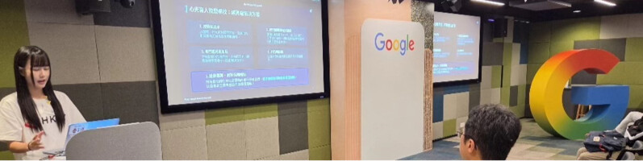

### profile_featured — Featured section cards and profile header banners/images on Esther's main LinkedIn profile page.
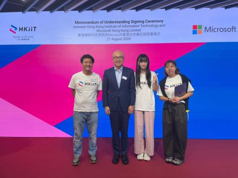

### profile_featured — Featured section cards and profile header banners/images on Esther's main LinkedIn profile page.
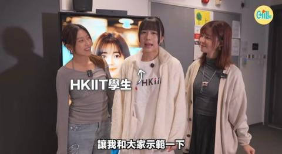

### profile_featured — Featured section cards and profile header banners/images on Esther's main LinkedIn profile page.
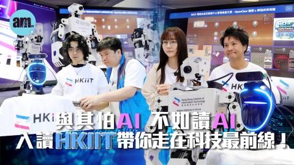

### profile_featured — Featured section cards and profile header banners/images on Esther's main LinkedIn profile page.
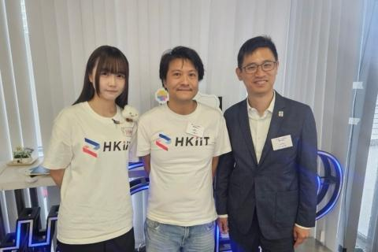

### profile_featured — Featured section cards and profile header banners/images on Esther's main LinkedIn profile page.
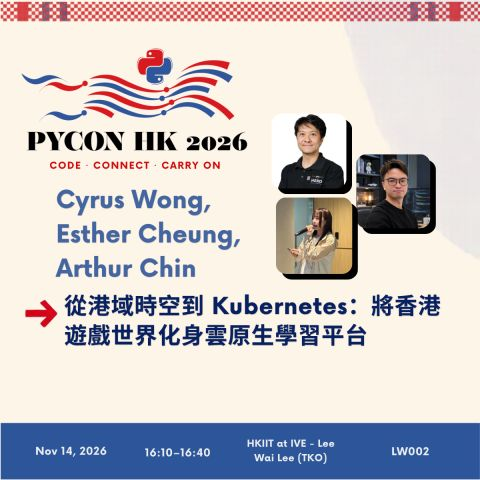

### profile_featured — Featured section cards and profile header banners/images on Esther's main LinkedIn profile page.
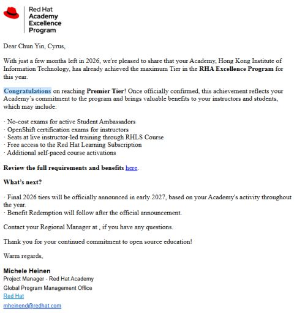

### profile_featured — Featured section cards and profile header banners/images on Esther's main LinkedIn profile page.
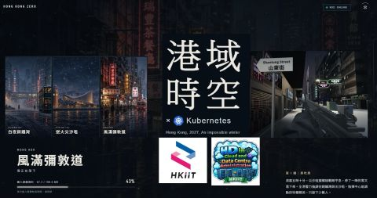

### pycon_hk — PyCon HK 2026 conference talk announcement poster featuring Cyrus Wong, Esther Cheung, and Arthur Chin


---
## 4. Verified LinkedIn Evidence Screenshots

### Esther Cheung - LinkedIn Profile Header, About & Featured (`profile_header`)
Main LinkedIn profile header, headline, About section, and Featured items for Hiu Tung Cheung (Esther). Highlights leadership roles as AWS Student Builder Group Leader, Google Developer Group on Campus Leader, and Red Hat Student Ambassador @HKIIT.
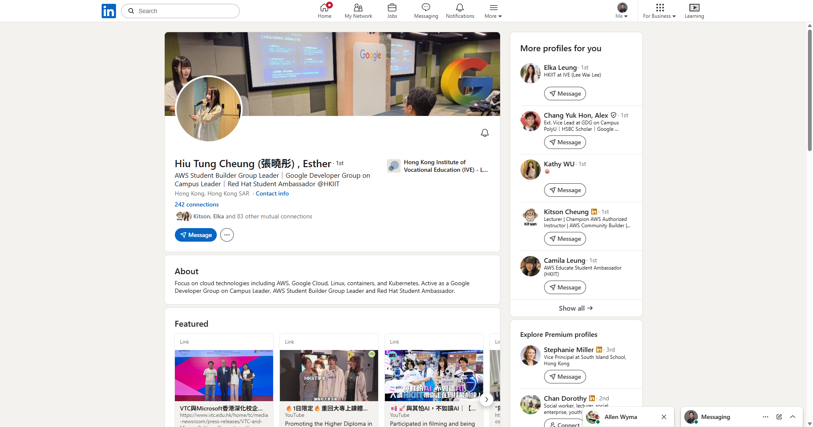

### Esther Cheung - Academic Background & Education (CGPA 3.91) (`academic_background`)
Esther Cheung's Education section showing Higher Diploma in Cloud and Data Centre Administration (Cloud Computing) at IVE Lee Wai Lee / HKIIT with an outstanding CGPA of 3.91/4.
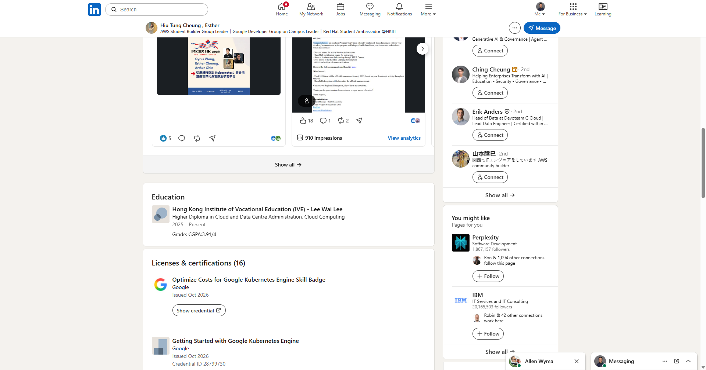

### Esther Cheung - Publications & Conference Presentations (`conference_talk`)
Esther Cheung's Publications section detailing talks at AWS Summit Hong Kong 2026 ('What Happens When an AI Agent Takes Control of a Robot?') and Hong Kong Open Source Conference (HKOSCon 2026, 'ProvePresent - AI Anti-Proxy Attendance System').
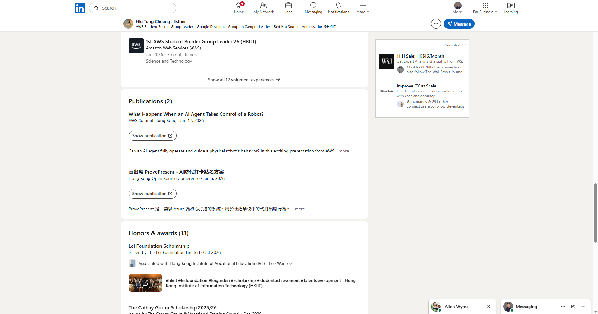

### PyCon Hong Kong 2026 Speaker Announcement - Kubernetes Game Learning Platform (`conference_talk`)
Announcement of Esther Cheung speaking at PyCon Hong Kong 2026 on '從港域時空到 Kubernetes: 將香港遊戲世界化身雲原生學習平台' (From Hong Kong Zero to Kubernetes: Transforming a Hong Kong Gaming World into a Cloud-Native Learning Platform) with Cyrus Wong and Arthur Chin. Demonstrates real-time integration of game events into Kubernetes verification tasks via WebSockets, Python state machines, and serverless architectures.
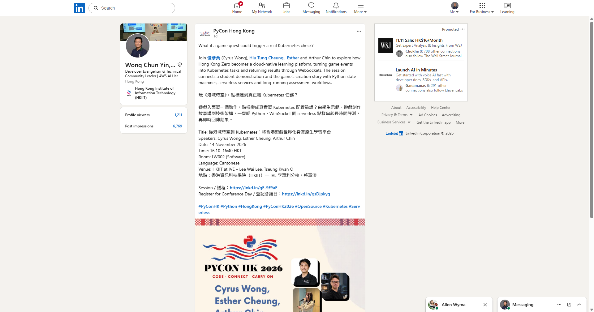

### Honors & Awards Page - Section 1 (`scholarship_award`)
Top section of Honors & Awards page showing Lei Foundation Scholarship, The Cathay Group Scholarship 2025/26, 8th GBA STEAM Excellence Award (Silver), and 10th GBA IT Application System Development Competition awards.
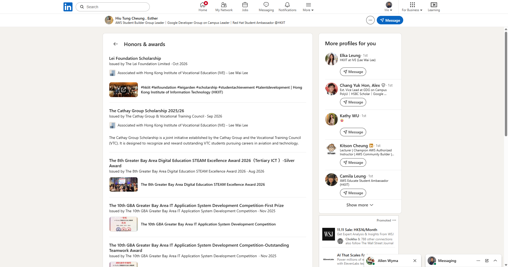

### Honors & Awards Page - Section 2 (`scholarship_award`)
Honors & awards middle section: 9th GBA Finals Second Prize, Energy Saving and Low Carbon Creation Tomorrow Competition 2024 Gold Award, The 2nd City I&T Grand Challenge Innovation Award, and 8th GBA Finals Best Application Award.
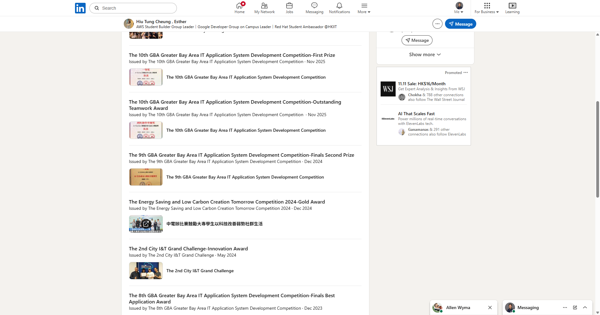

### Honors & Awards Page - Section 3 (`scholarship_award`)
Honors & awards page showing 8th GBA Finals Best Application Award, GBA STEM 2023 Excellence Award, Youth College Extracurricular Award, and Youth College Outstanding Learning Award.
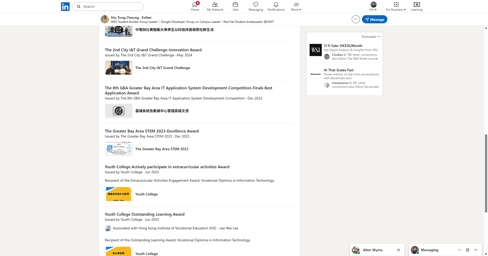

### Volunteering & Leadership - Red Hat, AWS Leader, GDG Leader (`leadership`)
Volunteering and Leadership section (part 1): Red Hat Student Ambassador, 1st AWS Student Builder Group Leader '26 (HKIIT), Google Developer Group on Campus Leader, AWS User Group HK meetup Presenter, GDGHK AI Session Presenter.


### Volunteering & Leadership - GDGHK AI Session & Microsoft MoU Presenter (`leadership`)
Volunteering and Leadership section (part 2): GDGHK AI Session Presenter, MoU Signing Ceremony HKIIT and Microsoft Hong Kong Limited Presenter (ProvePresent & Virtual Tutor Demo).


### Volunteering & Leadership - AWS Summit, HKOSCon, Google Cloud Leaders Connect (`leadership`)
Volunteering and Leadership section (part 3): AWS Summit HK 2026 Presenter, HKOSCon 2026 Presenter, Google Cloud Leaders Connect HK 2026 Presenter & Helper.


### Certifications - Part 1 (Google Cloud & GKE) (`certification`)
Licenses and Certifications page showing Google Cloud, Kubernetes Engine, and other technical badges.


### Certifications - Part 2 (Red Hat & Google Cloud) (`certification`)
Certifications page showing Red Hat System Administration I and Red Hat OpenStack Administration I certifications.


### Certifications - Part 3 (Red Hat & AWS) (`certification`)
Certifications page showing Red Hat Ansible, Podman/OpenShift, and AWS Academy credentials.
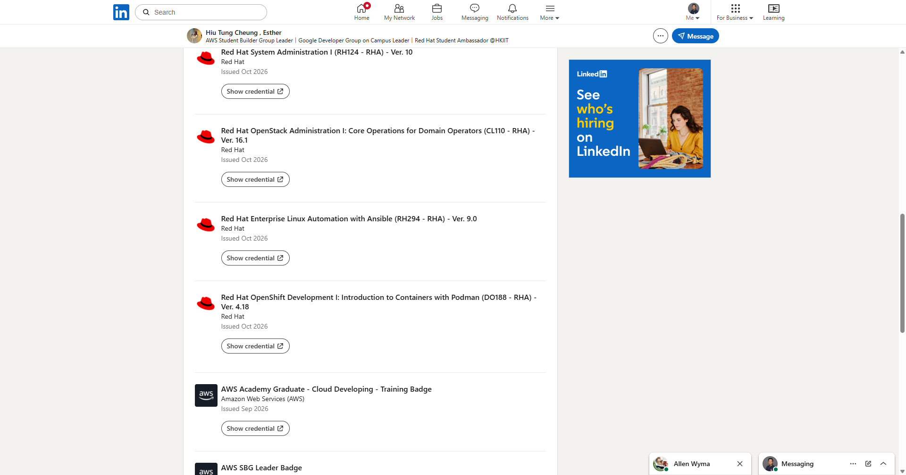

### Certifications - Part 4 (AWS Badges & Cloud Practitioner) (`certification`)
Certifications page showing AWS Cloud Practitioner and AWS Academy Graduate badges.


---
## 5. HKUST Computer Science Recommendation Letter

Here is the formal academic recommendation letter along with a complementary LinkedIn recommendation.

***

# PART A: Formal Academic Recommendation Letter

**Department of Information Technology**  
**Hong Kong Institute of Information Technology (HKIIT) / IVE (Lee Wai Lee)**  
Vocational Training Council, Hong Kong SAR  
Email: cyruswong@vtc.edu.hk | Web: https://hkiit.edu.hk  

November 18, 2026  

**Admissions Committee**  
Department of Computer Science and Engineering (CSE)  
The Hong Kong University of Science and Technology (HKUST)  
Clear Water Bay, Kowloon, Hong Kong  

**Subject: Strongest Recommendation for Hiu Tung Cheung (Esther / 張曉彤) — Bachelor of Engineering in Computer Science (BEng in CS)**

Dear Members of the Admissions Committee,

I am writing this letter with the highest degree of conviction to recommend **Hiu Tung Cheung (Esther / 張曉彤)** for direct-entry admission to the **Bachelor of Engineering in Computer Science (BEng in CS)** program at The Hong Kong University of Science and Technology (HKUST). 

I write from the dual perspective of her academic lecturer, research mentor, and technical co-presenter. As a Senior Lecturer in the Department of Information Technology at the Hong Kong Institute of Information Technology (HKIIT) / IVE (Lee Wai Lee) and an AWS Machine Learning & AI Hero, I have taught hundreds of aspiring software and cloud engineers over the past two decades. Esther stands at the absolute pinnacle of that cohort. Enrolled in our flagship **Higher Diploma in Cloud and Data Centre Administration**, she maintains a near-flawless **Cumulative GPA of 3.91 / 4.0**. Beyond her scholastic perfection, Esther possesses the rare engineering maturity to translate complex theoretical abstractions into industrial-grade, cloud-native distributed systems and applied artificial intelligence solutions.

### 1. Cloud-Native Distributed Systems Mastery & PyCon Hong Kong 2026
Esther’s grasp of systems programming, container orchestration, and asynchronous protocols matches that of senior university undergraduates. I invited Esther to co-author and co-deliver an invited technical paper with me and Arthur Chin at **PyCon Hong Kong 2026**, titled:  
*「從港域時空到 Kubernetes: 將香港遊戲世界化身雲原生學習平台」 (From Hong Kong Zero to Kubernetes: Transforming a Hong Kong Gaming World into a Cloud-Native Learning Platform)*.

In this project, Esther was central to engineering the bridge connecting *Hong Kong Zero* (an immersive 3D open-world environment) to enterprise Kubernetes clusters. She designed a high-throughput, low-latency event bus where in-game actions trigger asynchronous deployment and configuration verification tasks inside live container pods. Her architecture relied on **duplex WebSockets communication**, **Python finite state machines (FSM)**, and **serverless event-driven pipelines** that trace container lifecycle metrics, evaluate student infrastructure state machines, and stream dynamic grading telemetry back into the game engine in real time. Her command of distributed state orchestration was further underscored when she live-demonstrated running *DOOM* distributed across a Kubernetes cluster (`#doom × #k8s`) at both the AWS User Group Hong Kong and regional conferences.

### 2. Frontier Applied AI: Embodied Robotics, Computer Vision, and Microsoft Partnership
Esther does not merely consume developer APIs; she designs integrated AI architectures to solve real-world problems:
* **Embodied AI & Cloud Robotics (AWS Summit Hong Kong 2026):** Esther presented in the AWS Summit Developer Zone on *"What Happens When an AI Agent Takes Control of a Robot? [LIT-001]"*. She architected an embodied agentic workflow where Large Language Models (LLMs) break down unstructured visual and telemetry inputs into deterministic control primitives executed by physical micro-controllers over low-latency cloud connections.
* **Open Source Computer Vision (HKOSCon 2026):** At the Hong Kong Open Source Conference, Esther presented *"真出席 ProvePresent - AI防代打卡點名方案"*, a biometric authentication and anti-proxy attendance platform she architected using Microsoft Azure AI Vision, vector embeddings, and multi-factor verification to systematically eliminate academic fraud.
* **Institutional Representation (VTC × Microsoft Hong Kong Strategic Partnership):** Recognized for her technical poise, Esther was selected as the sole student keynote presenter for the official **VTC × Microsoft Hong Kong MoU Signing Ceremony**, where she demonstrated both *ProvePresent* and the *AI Virtual Tutor* before corporate executives and university leadership.
* **On-Device Agentic Workflows:** At Google Hong Kong’s office for the *"GDGHK Build with AI"* summit, she delivered technical workshops on *On-Device Intelligence & Agentic Web*, executing local small language models (SLMs) with client-side agent tool-calling frameworks.

### 3. Academic Distinction, Scholarships, and Regional Competition Honors
Esther’s academic track record is distinguished by competitive institutional scholarships and regional innovation championships across the Greater Bay Area (GBA):
* **Prestigious Scholarships:** Awarded both the competitive **Lei Foundation Scholarship** (recognizing elite institutional talent in computing) and **The Cathay Group Scholarship 2025/26** (awarded jointly by Cathay and VTC to top-tier engineering talent).
* **Competitive System Development:** 
  * **First Prize (一等獎) & Outstanding Teamwork Award** at the *10th GBA Greater Bay Area IT Application System Development Competition* for the `A-Eye` artificial intelligence vision system.
  * **Finals Second Prize (決賽二等獎)** at the *9th GBA IT Application Competition* for an autonomous driving safety inspection system (*AI全自動無人駕駛安全監管官*).
  * **Silver Award (Tertiary ICT)** at the *8th GBA Digital Education STEAM Excellence Award 2026*.
  * **Gold Award** at the *CLP Energy Saving and Low Carbon Creation Tomorrow Competition 2024* for her assistive IoT/AI energy analytics deployment.
  * **Innovation Award** at the HKSAR Government’s *2nd City I&T Grand Challenge*, organized by the Innovation and Technology Commission (ITC).

### 4. Technical Credentials & Unrivaled Campus Leadership
Esther holds **16 verified technical certifications and skill badges**, demonstrating an extraordinary range across all three hyperscalers and enterprise Linux:
* **Google Cloud & Containers:** *Optimize Costs for Google Kubernetes Engine (GKE)*, *Getting Started with GKE*, *Google Cloud Fundamentals: Core Infrastructure*, and *Essential Cloud Infrastructure: Foundations & Core Services*.
* **Red Hat Enterprise Architecture:** *Red Hat System Administration I (RH124)*, *Red Hat Enterprise Linux Automation with Ansible (RH294)*, *Red Hat OpenShift Development I: Introduction to Containers with Podman (DO188)*, and *OpenStack Administration I (CL110)*.
* **Amazon Web Services:** *AWS Certified Cloud Practitioner*, alongside official AWS Academy Graduate accreditations in *Cloud Developing*, *Cloud Operations*, *Cloud Architecting*, and *Cloud Foundations*.

Simultaneously, Esther is a catalyst for institutional change. She holds the unprecedented distinction of serving concurrently as the **Inaugural AWS Student Builder Group Leader '26 (HKIIT)**, the **Google Developer Group (GDG) on Campus Leader**, and the **first official Red Hat Student Ambassador in Hong Kong**, an initiative that propelled HKIIT to achieve *Premier Tier* status in the Red Hat Academy Excellence Program. Despite this exhaustive workload, she regularly dedicates weekends to teaching generative AI literacy to non-technical elderly citizens through community workshops organized with CLP Power.

### Summary
The Department of Computer Science and Engineering at HKUST is internationally celebrated for academic rigor, algorithmic foundations, and cutting-edge systems research. Esther Cheung embodies the intellectual resilience, engineering discipline, and collaborative leadership that HKUST values most. She has mastered container runtimes, distributed cloud patterns, and applied AI at a level seldom observed in transfer applicants. 

I give **Hiu Tung Cheung (Esther)** my highest, most enthusiastic, and unreserved recommendation. She will not only excel in your Computer Science curriculum but will emerge as an intellectual and community leader within the CSE department. Please feel free to contact me should you require any additional supporting documentation.

Sincerely,

```
[Signature]
```

**Cyrus Wong (黃俊彥)**  
Senior Lecturer, Department of Information Technology  
Leader, Cloud Innovation Centre  
Hong Kong Institute of Information Technology (HKIIT) / IVE (Lee Wai Lee)  
AWS Machine Learning Hero | AWS AI Hero  
Email: cyruswong@vtc.edu.hk  
Tel: +852 3928 2000  

***

# PART B: Endorsement for Esther’s LinkedIn Profile

**Recommendation by Cyrus Wong (黃俊彥) for Hiu Tung Cheung (Esther / 張曉彤):**

> "It is rare to encounter a student who blends academic brilliance, low-level systems engineering, and community leadership as seamlessly as Esther (Hiu Tung) Cheung.
> 
> As her lecturer and mentor at HKIIT / IVE, I have had the privilege of observing Esther’s exceptional trajectory. In the classroom, her near-perfect **3.91 / 4.0 CGPA** in Cloud and Data Centre Administration speaks to her rigorous work ethic. But her real distinction lies in her ability to architect production-ready, mission-critical systems.
> 
> I invited Esther to co-present alongside me at **PyCon Hong Kong 2026**, where we detailed how we transformed the *Hong Kong Zero* open-world 3D environment into a cloud-native educational platform (*「從港域時空到 Kubernetes」*). Esther’s design integrated real-time WebSockets, Python finite state machines, serverless pipelines, and live Kubernetes verification checks with extraordinary architectural poise. Her technical scope spans the entire cloud ecosystem: from presenting embodied robotics AI agents at **AWS Summit Hong Kong**, to architecting her Azure computer vision anti-proxy system (*ProvePresent*) at **HKOSCon**, to presenting before executive leadership at the official **VTC × Microsoft Hong Kong Strategic Partnership Ceremony**, and delivering live multi-agent sessions at Google Hong Kong.
> 
> Holding 16 professional certifications across AWS, Red Hat (Ansible, Podman/OpenShift, OpenStack, RHCSA), and Google Cloud (GKE Optimization), she is equally unmatched as a builder of communities. As HKIIT’s **1st AWS Student Builder Group Leader**, **GDG on Campus Leader**, and **Hong Kong’s first Red Hat Student Ambassador**, she has empowered hundreds of her peers to write code, deploy containers, and pass industry certifications.
> 
> Winner of the **Cathay Group Scholarship**, the **Lei Foundation Scholarship**, and championships across the Greater Bay Area IT Competitions, Esther represents the absolute top echelon of young computer science talent in Hong Kong. She has my highest recommendation for university admission and any elite engineering team."